# Tinker Party!
A proof-of-concept beta version of a Unity Game that is able to connect real-time to an Arduino and a breadboard. Learning through party games of 1v1s!

## Screenshots
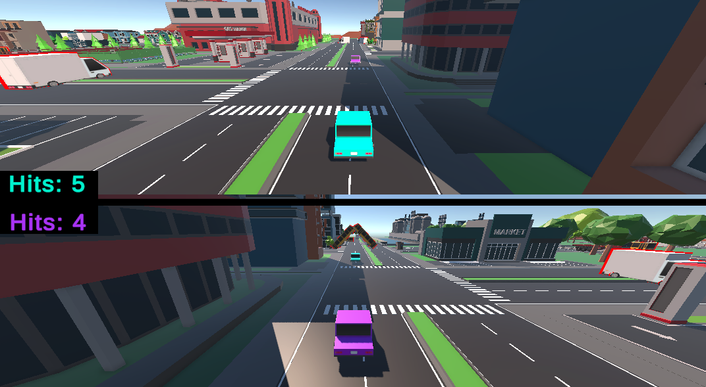
Minigame 1

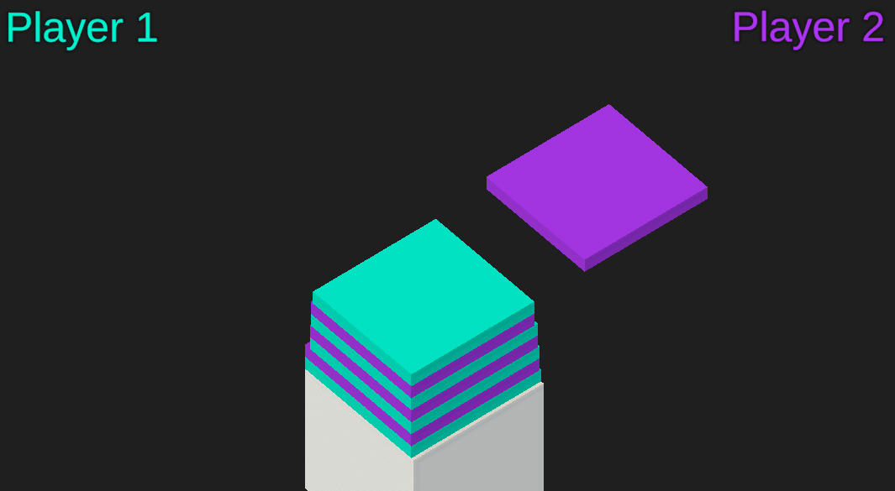
Minigame 2

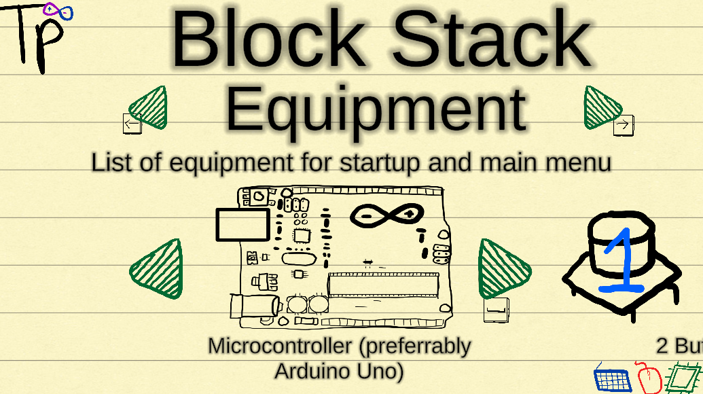
Required equipment being listed in a carousel

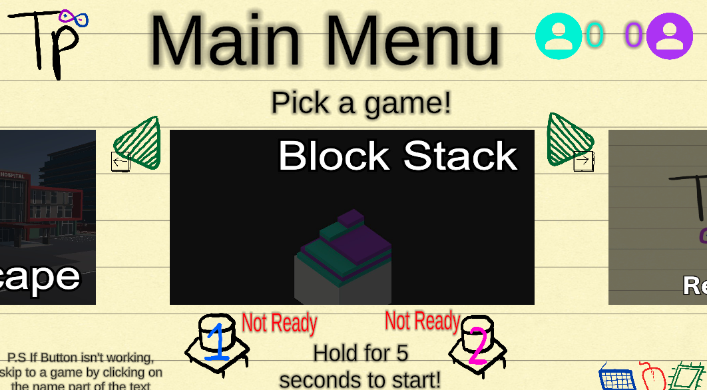
Main menu of carousel of minigames

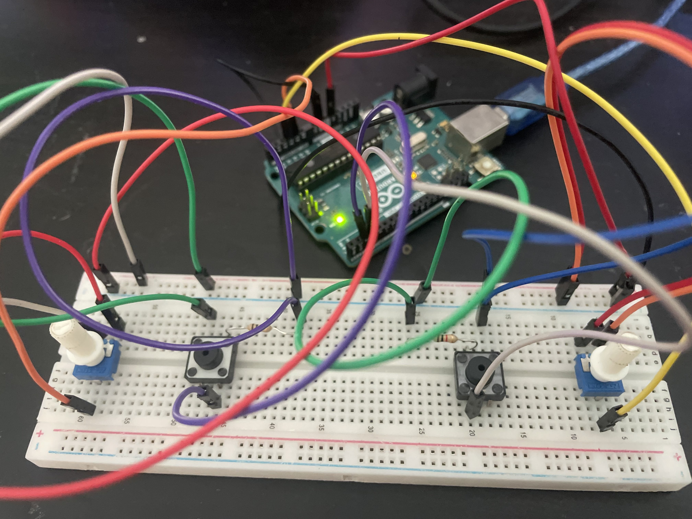
Photo of my controller combining both schematics

## Why I made it
I like party video games like Mario Party. I also like breadboards and electronic components.
So, I decided to combine them in a way inspired also by another game, *LEGO Dimensions*, where real life building and tinkering (heh) was interacted with by the software.

This game is for those who are also interested in having fun while learning about Arduino and circuits. 
What makes it different to other ways of learning Arduino is that it balances the aspects of fun, as well as hands-on experience.

## Features
The following is a list of all the features included in the current version of the game

### Communication through Serial Port
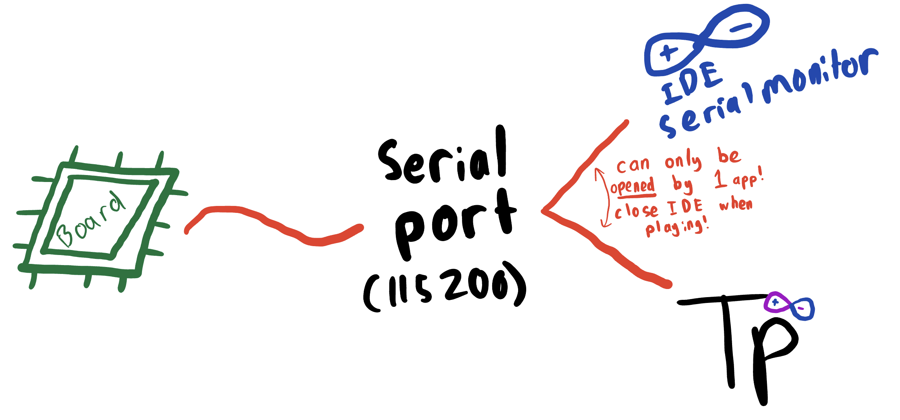
The above is a diagram I drew to explain my understanding.

The main road of communication between the board and the computer is through the serial port.

There is "traffic" whenever two apps try to read from the port, such as when I tried seeing the readings on the IDE while testing if actions happened in game. The error occurs, and so I had to quit one or the other.

There were some small tweaks I added to the Serial Communication:
- 115200 baud (good enough to fit the rate of readings I want)
- A buffer in the readings (no buffer made it too quick and led to some overloads)

*P.S: if your computer runs differently, slower or faster, just tweak these in the ArduinoConnector.cs, which is later on in the .md*

### Hand drawn icons
The hand drawn images, such as arrows, logos, images of equipment, was drawn by yours truly (I'll be honest, I traced the Arduino, but just that, promise).
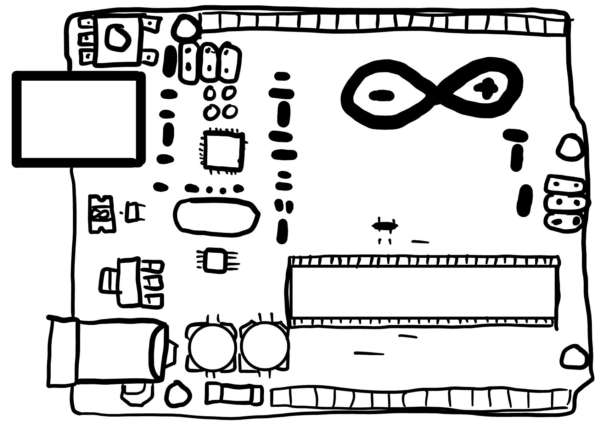

I hope you enjoy those! I *tried* to go for a notebook aesthetic, but some issues with a pencil-type font, so text used the Unity standard.

### Pre-made Arduino Code
For the sake of simplicity, I made just one file, instead of making the user copy and upload a .uno for each minigame. That one's fully commented for anyone interested on seeing the Arduino end. More on that in [How to play](#how-to-play).

### 2 Minigames
Each of them have their own component of interest, but more on that during [Minigames](#minigames).

### CAD to show Hardware setup
To know the setup for each game, I created a diagram on TinkerCad for each minigame. More on this in [Hardware and Circuit Setup](#hardware-and-circuit-setup)

### Multi-input during menus
Say something goes wrong in the middle of a menu, say the port changes or the Arduino resets, etc. To prevent you being stuck in the menu without button controls, you can use the mouse and keyboard to navigate back to the setup menu to fix up. Or if you're in a minigame setup menu, just scroll to the end.


## Minigames
As of now, 2 minigames, each with their own specific skills and genres


### Minigame 1 - City Escape

Component of Interest: Potentiometers

Objective: Use the potentiometer to drift left and right to avoid obstacles

Win condition: At the end of the 90s, the winner is the player with less collisions. If equal, it is a tie


### Minigame 2 - Block Stack
Component of Interest: Buttons

Objective: Stack the block in the right time as it glides across the tower

Win condition: When the other player misses their stack. So, the game could *technically* go on infinitely


## Hardware and Circuit Setup

### Total hardware needed:
- 1x Microcontroller board (preferrably Arduino Uno)
- 1x Breadboard
- 8x jumper wires total
- 2x 1k Ohm resistor
- 2x Pushbuttons
- 2x Potentiometers

Again, at different stages of the game, not all of these are required. However for a quick run through, you could combine both of the following schematics into one:


### Schematics of each minigame
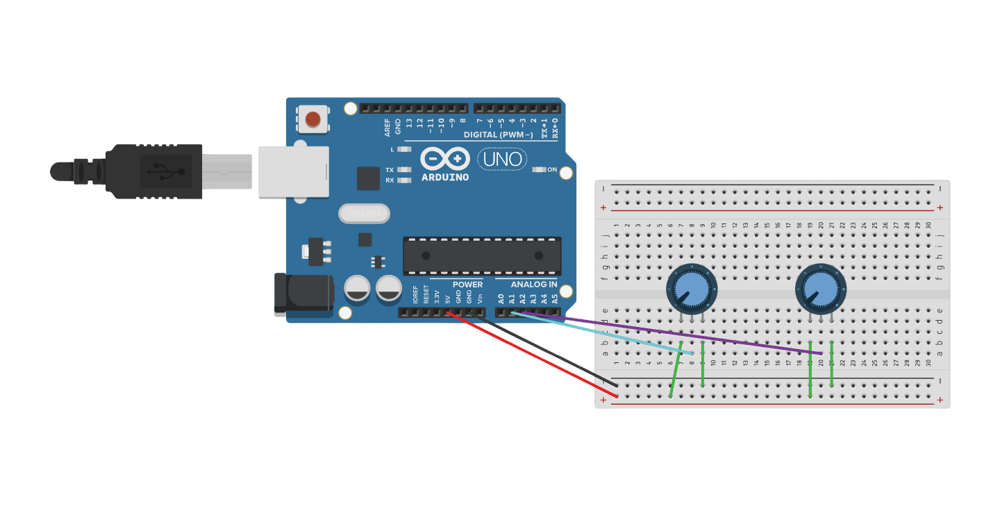
Schematic for Minigame 1


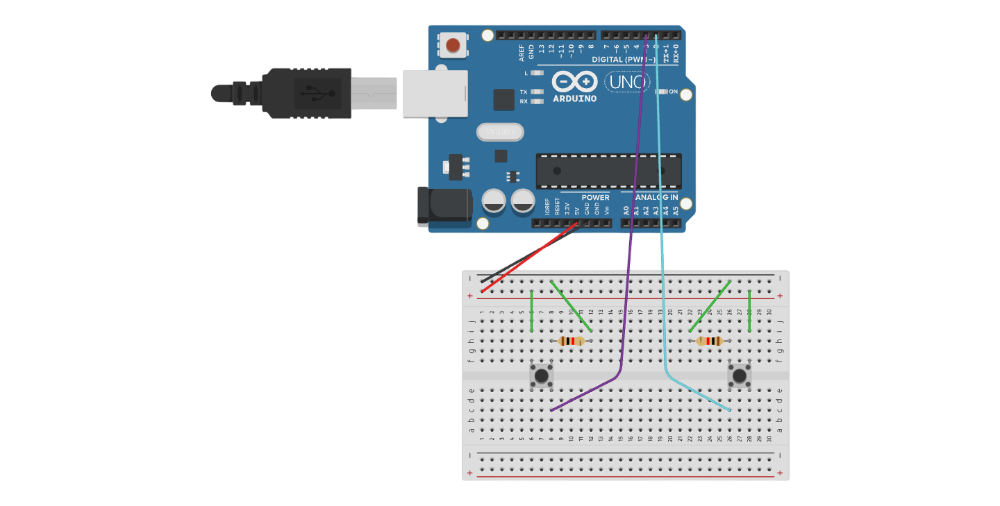
Schematic for Minigame2

### About the Port
In the game, you are given a textbox to copy and paste the address of the port you are connected to.

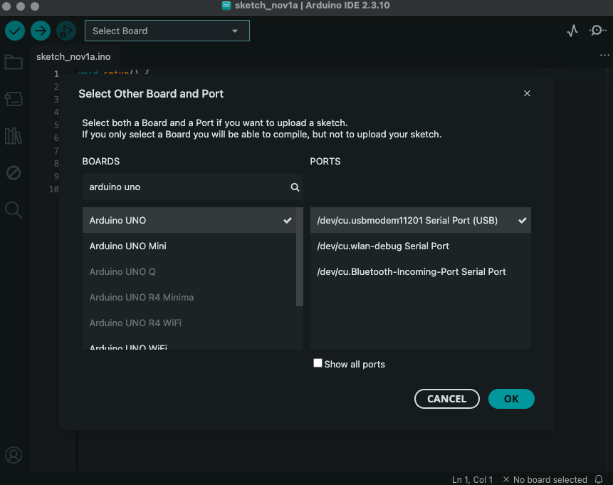
For example, I would copy in "/dev/cu.usbmodem11201"
(*well without quotations of course*)

### ArduinoConnector.cs
Upload this onto your Arduino through the IDE. Feel free to read and adjust, if you have different pins needed. The result of this code is only output in Serial Port, so any logistics of pins or baud can be adjusted here
```
// This is the required uno code to upload before running game, also on the github repo.

// defines the pin locations
const int potPin1 = A1; //potentiometer pins, player1 = analog 1, player2 = analog 2
const int potPin2 = A2;
#define butPin1 2 // buttons = digital pins, D2/D3 = P1/P2
#define butPin2 3

void setup() {
  Serial.begin(115200); // opens serial port to send readigns to, this is main method of communication with unity
  pinMode(potPin1, INPUT); //defines all of them as input
  pinMode(potPin2, INPUT);
  pinMode(butPin1, INPUT);
  pinMode(butPin2, INPUT);
}

void loop() {
  int readValue1 = analogRead(potPin1); //retreives values and prints
  int readValue2 = analogRead(potPin2);
  Serial.println("1:" + String(readValue1)); //i use 1: and 2: etc, so when reading checks the first integer to see what it is. e.g 1 means player 1 potentiometer, etc
  Serial.println("2:" + String(readValue2));
  int readValue3 = digitalRead(butPin1);
  int readValue4 = digitalRead(butPin2);
  Serial.println("3:" + String(readValue3));
  Serial.println("4:" + String(readValue4));
  delay(20); // small delay to prevent lag with overflow
  }

```


## How to play

### Downloading
To get the actual app, [Download here]()

It'll lead you to the itch.io page where you can download form either macOS or Windows (for now)

*P.S: I must warn that I haven't tested the Windows version, only macOS, hopefully it runs as smoothly*

### The gameplay loop
1) Start with the **Startup menu**. Watch the starting animations, introductions, then scroll through the menus to read information

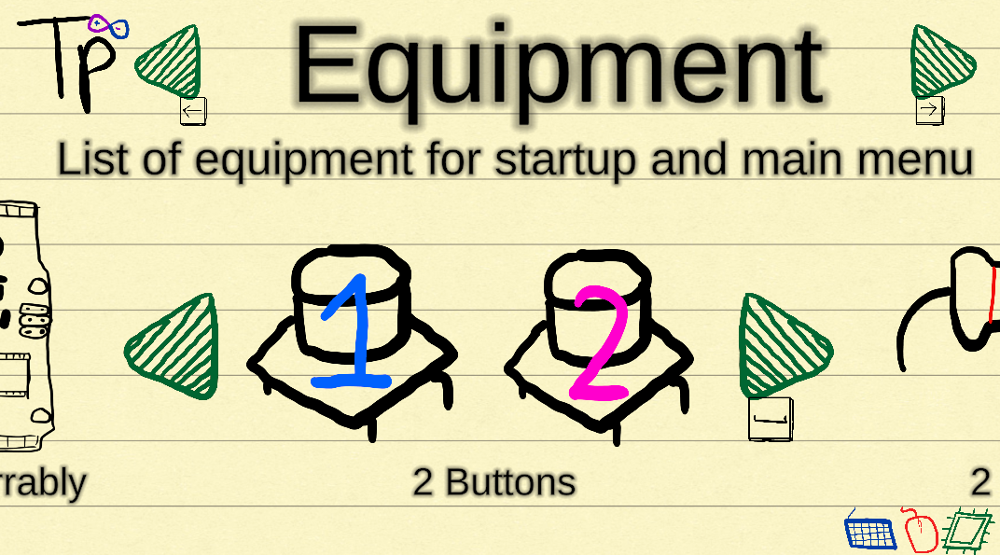

2) Setup the breadboard and necessary hardware
3) Upload the code to the Arduino, copy in the port address, then **close** the IDE
4) Enter the main menu

5) The loop begins! Select your game from the main menu and follow on-screen instructions to play

### Example of what starting a minigame looks like

1) Scroll through the setup menu. The menu all have the same headings

Equipment -> Setup Hardware -> Final Mentions -> Final Test


Example of Equipment list from Minigame 2

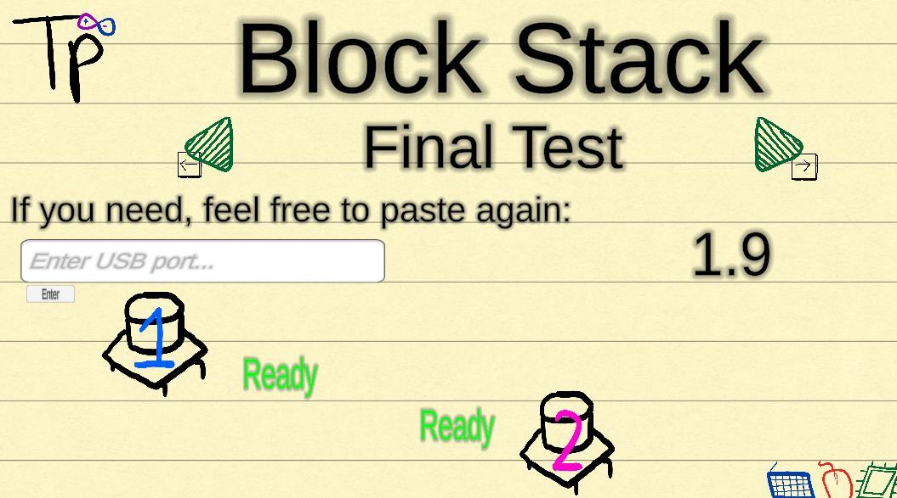
Example of Final button test before moving on to actual minigame


## Running from source

1. Install Unity Hub and Unity Editor version `6000.3.1f1`.
2. In Unity Hub, choose **Add project from disk** and select the Tinker Party folder containing `Assets`, `Packages`, and `ProjectSettings`.
3. Open the project, then open `Assets/Scenes/Startup.unity`.
4. Press **Play** in the Unity Editor.

For Arduino setup, see [Hardware and Circuit Setup](#hardware-and-circuit-setup).


## How it was made
This project was fully Unity and VS Code, with other assets made on other software. The Hackatime Pie Chart shows:

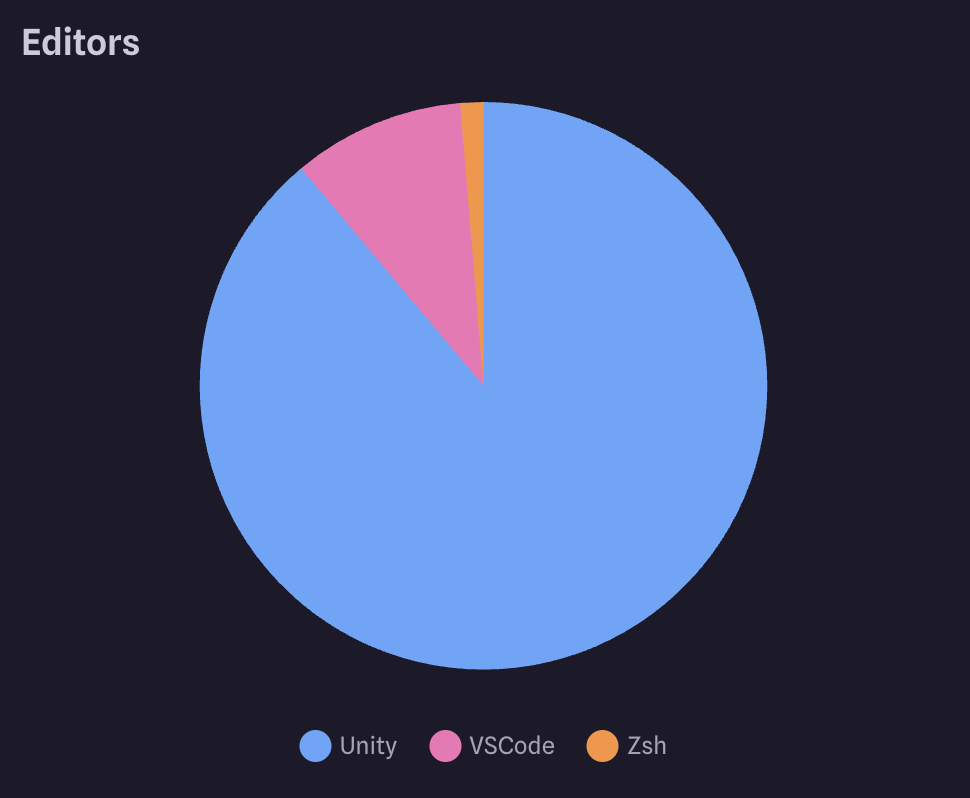
*P.S, I only realised my VSCode Hacaktime extension was disabled for half the project, so expect it to be a wider chunk*

### Unity - Main Game development
This was of course where all the game mechanics were. From UI, to timeline animations, to gameplay works and managing input, this is the base that ran everything.

### VSCode - Coding software
Allowed me to organise my code and also built-in Terminal to push to gitHub

### Graphic Design
Hand drew (and traced) my icons on Notability, on my Ipad. I then airdropped to my mac, made it bgless using Photoroom, them added it to the project

UI such as minigame icons were made on a mix of Pixlr  (Photo Editor) and Canva

## Known limitations and future plans

This was always meant to be a proof-of-concept, that ArduinoxUnity communication could work. So it has served its purpose for now.

However, actually working on this project has made me think of many more features, including:

### Minigame 1 improvements
- A smoother ride, Timeline keyframes were made off of pure vibes, which led to some speeding up and down a lot
- Disappearing enemies, there's no current, double-collide issue, but it adds to the overall fun of the game

### Minigame 2 Improvements
- Remove the weird thing where player 2 has to tap once before starting
- Falling block has the same colour
- Maybe a more appealing background rather than just black?

### Overall gameplay improvements
- Sound!! No time for major sound effects or music scores
- Particles!! Brings the game to life and we all know how good Unity Particle System is. This could be from selection, from explosions, etc, just to make the thing less static
- Settings option, for maybe a more accessible port reuploader, maybe a get unstuck guide or also to sort out the sounds above
- Window size options. I fixed the screen ratio to a Window of 16:9 ratio that cant be resized (cuz it keeps messing up with the Canvas UI) 

### Future project plans
These are about the main game, and now about the mini-game, proof-of-concept version this is:
- Story mode, introduce some characters
- More informational parts
- Customisable themes
- WAYY more levels/minigames
- DLCs with outside Arduino tools and extra applications (not necessarily paid)
- Save progress, know which levels you've passed

## Credits and acknowledgements

Being a proof-of-concept, and one of the first fully individual games I've made on Unity, I've had a lot of help.


### Tutorials
I'd like to thank the following Youtube Tutorials first, which were extremely helpful at not only showing, but explaining so that I was able to adapt and add more myself.

[DIY TechRush - "How to Connect Arduino to Unity"](https://www.youtube.com/watch?v=LzG_-tL2Fg0) - The core concept of connecting through the serial port

[AAvirusAA - "How To Make Outline Shader in UNITY"](https://www.youtube.com/watch?v=d89qqVGUHtA) - Adding the cartoony outline to enemies in Minigame 1

[Jason Weimann - "Build Stack"](https://www.youtube.com/watch?v=-6LRXBtbNHg) - The basis of Minigame 2

### Objects/Assets
For minigame 1, the cars and cities were online free sources

[Cartoon Low Poly City Cars Pack - antonmoek](https://free3d.com/3d-model/cartoon-low-poly-city-cars-pack-32084.html?dd_referrer=)

[Low Poly City Pack - ilkhom23](https://www.cgtrader.com/free-3d-models/exterior/cityscape/low-poly-city-01-ready-collection)

[Photoroom](https://www.photoroom.com/tools/background-remover) - such a good free background remover, I basically used for every asset


# END
I hope you enjoy Tinker Party!