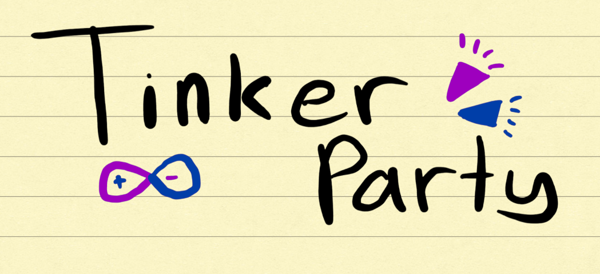

# Tinker Party!
A proof-of-concept beta version of a Unity Game that is able to connect real-time to an Arduino and a breadboard. Learning through party games of 1v1s!

## Screenshots

## Why I made it
I like party video games like Mario Party. I also like breadboards and electronic components.
So, I decided to combine them in a way inspired also by another game, Lego Dimensions, where real life actions and construction lead to actual use in the virtual world.
This game is for those who are also interested in having fun while learning about Arduino and circuits. 
What makes it different to other ways of learning Arduino is that it balances the aspects of fun, as well as hands-on experience.

## Features

## Minigames

## Hardware and Circuit Setup

## How to play

## How it was made

## Running from source

## Known limitations and future plans

## Credits and acknowledgements